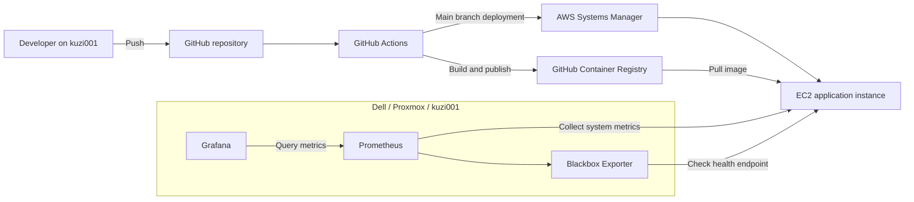

# LearnIT DevOps Project - Piotr Kuzniak

A diploma project demonstrating AWS infrastructure as code, automated
container deployment, CI/CD, and application and infrastructure monitoring.

## Architecture

- **AWS EC2:** runs the Python application in Docker.
- **Terraform:** provisions the network, EC2 instance, security groups, and IAM resources.
- **GitHub Actions:** builds and publishes images after every branch push.
- **GitHub Container Registry (GHCR):** stores images tagged with the commit SHA.
- **AWS Systems Manager (SSM):** executes application deployments on EC2.
- **Dell / Proxmox / kuzi001:** provides development, local testing, and monitoring.
- **Prometheus:** collects infrastructure metrics and application probe results.
- **Node Exporter:** exposes EC2 CPU, memory, and filesystem metrics.
- **Blackbox Exporter:** checks the application health endpoint.
- **Grafana:** displays automatically provisioned dashboards.



## Repository Files

The repository contains 24 tracked files.

| File | Description |
| --- | --- |
| `.github/workflows/ci.yml` | Builds and publishes images, deploys from main through SSM, and defines optional SMTP notifications. |
| `.gitignore` | Excludes credentials, environment files, Terraform state and plans, and Python cache files. |
| `README.md` | Documents the architecture, project files, setup, verification, and limitations. |
| `app/Dockerfile` | Builds the Python image and runs the application as a non-root user. |
| `app/main.py` | Implements the HTTP application, version response, and health endpoint. |
| `docs/requirements.md` | Summarizes the diploma project requirements. |
| `infra/.terraform.lock.hcl` | Records the selected AWS provider version and package checksums. |
| `infra/bootstrap.sh` | Installs and enables Docker and Node Exporter during initial EC2 provisioning. |
| `infra/compute.tf` | Selects an Ubuntu image and defines the application EC2 instance. |
| `infra/deploy-iam.tf` | Defines the deployment user and its restricted SSM permissions. |
| `infra/iam.tf` | Defines the EC2 IAM role and instance profile for SSM. |
| `infra/network.tf` | Creates the VPC, public subnet, internet gateway, and routing. |
| `infra/outputs.tf` | Outputs the instance ID, public IP, application URL, and SSH command. |
| `infra/providers.tf` | Configures the AWS region and default resource tags. |
| `infra/security.tf` | Defines application, SSH, monitoring, and outbound network rules. |
| `infra/ssh.tf` | Registers the administrator's public SSH key with AWS. |
| `infra/variables.tf` | Defines the project name, instance type, and administrator network address. |
| `infra/versions.tf` | Declares Terraform and AWS provider version constraints. |
| `monitoring/blackbox.yml` | Defines an HTTP probe requiring status 200 and a healthy response body. |
| `monitoring/compose.yml` | Runs Prometheus, Grafana, and Blackbox Exporter on kuzi001. |
| `monitoring/grafana/dashboards/learnit.json` | Defines application health and EC2 resource usage panels. |
| `monitoring/grafana/provisioning/dashboards/default.yml` | Automatically loads dashboards into the LearnIT folder. |
| `monitoring/grafana/provisioning/datasources/prometheus.yml` | Automatically configures the Prometheus data source. |
| `monitoring/prometheus.yml` | Configures Prometheus self-monitoring, EC2 metrics, and application probes. |

## Local Files Not Published to Git

| File or directory | Description |
| --- | --- |
| `infra/terraform.tfvars` | Local variable values, including the administrator's public IPv4 CIDR. |
| `infra/terraform.tfstate` | Terraform's record of managed resources. Preserve securely. |
| `infra/terraform.tfstate.backup` | Local Terraform state backup. |
| `infra/deployment.tfplan` | Saved deployment plan. |
| `infra/destroy.tfplan` | Saved destruction plan, when generated. |
| `infra/.terraform/` | Downloaded providers and local Terraform working data. |
| `monitoring/.env` | Local Grafana administrator password. |
| `app/__pycache__/` | Generated Python bytecode cache. |

Docker volumes store Prometheus metrics and Grafana data outside the repository.

Never publish local state, plans, passwords, or credentials.

## Prerequisites

On the Dell development server:

- Git
- Docker Engine
- Docker Compose
- Terraform matching `infra/versions.tf`
- AWS CLI with credentials authorized to manage the declared resources
- A public SSH key at `~/.ssh/id_ed25519.pub`
- The corresponding private key for SSH access

The configured AWS region is `eu-north-1`.

AWS resources consume credits or incur charges according to the account plan.
Monitor the available credit balance and remove resources when no longer needed.

## Application

The application listens on port 8000.

| Endpoint | Description |
| --- | --- |
| `/` | Returns a welcome message and application version. |
| `/health` | Returns HTTP 200 and `{"status": "ok"}`. |
| Other paths | Return HTTP 404. |

The `APP_VERSION` environment variable identifies the deployed commit.
Its default value is `dev`.

### Local Build and Test

Run from the repository root:

```bash
docker build -t learnit-app:dev ./app
```

Start the application:

```bash
docker run -d --name learnit-app-test -p 8000:8000 learnit-app:dev
```

Check its health:

```bash
curl --fail http://127.0.0.1:8000/health
```

Expected response:

```json
{"status": "ok"}
```

Check the application:

```bash
curl --fail http://127.0.0.1:8000/
```

Remove the local test container:

```bash
docker rm -f learnit-app-test
```

## Infrastructure Provisioning

Terraform creates:

- A VPC
- A public subnet
- An internet gateway
- A route table and subnet association
- A security group and access rules
- An EC2 SSH key pair
- An EC2 instance with an encrypted root disk
- An EC2 IAM role and instance profile for SSM
- A dedicated deployment user and SSM policy

The instance uses Ubuntu 24.04 and defaults to `t3.micro`.
T3 CPU credits use standard mode.

### Local Variables

Create `infra/terraform.tfvars`:

```hcl
admin_cidr = "YOUR_PUBLIC_IPV4/32"
```

Use the public IPv4 address of the Dell network.
Do not use the private VM address.

This file is excluded from Git.

### Provisioning Commands

Initialize Terraform:

```bash
terraform -chdir=infra init
```

Validate the configuration:

```bash
terraform -chdir=infra validate
```

Create a plan:

```bash
terraform -chdir=infra plan -out=deployment.tfplan
```

Review the plan before applying:

```bash
terraform -chdir=infra show deployment.tfplan
```

Apply the reviewed plan:

```bash
terraform -chdir=infra apply deployment.tfplan
```

Display outputs:

```bash
terraform -chdir=infra output
```

The bootstrap script automatically installs and enables Docker and Node Exporter.

Application deployment is performed separately through GitHub Actions.

### Terraform State and Replacement

The project currently uses local Terraform state.
Preserve the state and its backup securely.

The configuration reads the SSH public key from:

```text
~/.ssh/id_ed25519.pub
```

The subnet availability zone is configured as `eu-north-1a`.

Changing `bootstrap.sh` forces EC2 replacement because
`user_data_replace_on_change` is enabled.

The AMI lookup selects the latest matching Ubuntu image.
A newly published matching image can also cause a future plan to propose
EC2 replacement.

Always inspect plans before applying changes.

EC2 replacement requires updating:

- The `EC2_INSTANCE_ID` GitHub Actions variable
- Both EC2 addresses in `monitoring/prometheus.yml`
- The current application address in this documentation

The public EC2 address is not an Elastic IP.
It may change after an instance stop/start or replacement.

### SSM Readiness

After provisioning, confirm that the instance is Online in Systems Manager:

```bash
aws ssm describe-instance-information \
  --region eu-north-1 \
  --filters Key=InstanceIds,Values=YOUR_INSTANCE_ID \
  --query 'InstanceInformationList[].{ID:InstanceId,Status:PingStatus}' \
  --output table
```

If the agent started before its IAM role became available,
connect over SSH and restart it:

```bash
sudo systemctl restart snap.amazon-ssm-agent.amazon-ssm-agent.service
```

## CI/CD

The workflow is stored in `.github/workflows/ci.yml`.

### Every Branch Push

1. Checks out the repository.
2. Builds the application image.
3. Publishes the image to GHCR.
4. Tags it with the full commit SHA.

Image naming:

```text
ghcr.io/pkuzniak/project_learnit:<commit-sha>
```

### Main Branch Deployment

A push to `main` additionally:

1. Waits for a successful build.
2. Sends a deployment command through SSM.
3. Pulls the image onto EC2.
4. Removes the previous application container.
5. Starts the new container with the commit SHA as `APP_VERSION`.
6. Checks `/health`, retrying startup connection errors.
7. Reports the deployment result to GitHub Actions.

The workflow can also be started manually using **Run workflow**.
Select `main` to include deployment.

Deployment uses:

- Container name: `learnit-app`
- Port mapping: `8000:8000`
- Restart policy: `unless-stopped`

Replacing the container causes a short interruption.
Automatic rollback is not implemented.

### GitHub Actions Configuration

Repository secrets:

| Name | Purpose |
| --- | --- |
| `AWS_ACCESS_KEY_ID` | Access key ID of the dedicated deployment user. |
| `AWS_SECRET_ACCESS_KEY` | Secret access key of the dedicated deployment user. |

Repository variable:

| Name | Current value |
| --- | --- |
| `EC2_INSTANCE_ID` | `i-0114c5f0e8c7007c3` |

Create the deployment user's access key outside Terraform.
Store its values directly in GitHub Secrets, without spaces or trailing newlines.

Do not use the administrator's AWS credentials for deployments.

The deployment user can execute shell commands through SSM only on the
application instance. Its command-result read permission uses a wildcard
resource.

Keep the GHCR package public so EC2 can pull images without registry credentials.

OIDC configuration could not be completed because the account's organization
policy denied the required IAM read operations.

## Email Notifications

SMTP notification code is implemented but disabled and not yet tested.

The current recipient is a placeholder:

```text
example321@example.com
```

Replace it with a real recipient before enabling delivery.

Required repository secrets:

| Secret | Purpose |
| --- | --- |
| `SMTP_HOST` | SMTP server hostname. |
| `SMTP_PORT` | SMTP server port. |
| `SMTP_USERNAME` | SMTP login name. |
| `SMTP_PASSWORD` | SMTP password or application password. |
| `MAIL_FROM` | Sender email address. |

After configuring SMTP and replacing the recipient, set the repository variable:

```text
MAIL_ENABLED=true
```

Port 465 uses implicit TLS.
Other configured ports use STARTTLS.

When enabled, the notification job runs after build and deployment finish,
including failure or skipped results.

The email includes:

- Branch
- Commit SHA
- Build result
- Deployment result
- Workflow run link

The diploma notification requirement remains incomplete until real email
delivery has been tested.

## Monitoring Setup

Monitoring runs on kuzi001, separately from the application EC2 instance.

### Grafana Password

Create `monitoring/.env`:

```dotenv
GRAFANA_ADMIN_PASSWORD='YOUR_STRONG_UNIQUE_PASSWORD'
```

Use a unique password and do not commit this file.

Restrict access:

```bash
chmod 600 monitoring/.env
```

### Start Monitoring

Validate Compose configuration without displaying resolved secrets:

```bash
docker compose --env-file monitoring/.env -f monitoring/compose.yml config --quiet
```

Start the stack:

```bash
docker compose --env-file monitoring/.env -f monitoring/compose.yml up -d
```

The stack contains:

- Prometheus
- Grafana
- Blackbox Exporter

Grafana automatically provisions the Prometheus data source and LearnIT dashboard.

### Dashboard

The dashboard includes:

- Application health
- EC2 metrics collection status
- CPU usage
- Memory usage
- Root filesystem usage
- HTTP probe duration

Dashboard URL:

```text
http://192.168.18.100:3000/d/learnit-overview
```

Log in as `admin` using the password from `monitoring/.env`.

### Data Collection

Prometheus collects metrics every 15 seconds.

Configured jobs:

| Job | Purpose |
| --- | --- |
| `prometheus` | Prometheus self-monitoring. |
| `ec2-node` | EC2 system metrics from Node Exporter. |
| `app-health` | Application health checks through Blackbox Exporter. |

The HTTP probe requires:

- HTTP status 200
- A response body containing `"status": "ok"`

Prometheus retention is configured for 15 days and a 5 GB size limit.
Data may be removed earlier when the size limit is reached.

Prometheus and Grafana data persist in Docker volumes.

### Current Network Layout

| Address | Purpose |
| --- | --- |
| `10.10.10.1` | Proxmox internal bridge address. |
| `10.10.10.10` | Private address of kuzi001. |
| `192.168.18.100` | Proxmox Wi-Fi address used for NAT access. |
| `http://192.168.18.100:3000` | Grafana through Proxmox NAT. |
| `http://10.10.10.10:3000` | Grafana on the internal network. |
| `http://127.0.0.1:9090` | Prometheus, accessible directly only on kuzi001. |
| `http://51.20.252.245:8000` | Current EC2 application endpoint. |
| `http://51.20.252.245:9100/metrics` | EC2 metrics, restricted to the administrator network. |

Grafana binds to `10.10.10.10:3000`.
Adjust this address when running monitoring on another host.

EC2 access rules:

| Port | Access |
| --- | --- |
| TCP 8000 | Public application access. |
| TCP 22 | SSH from `admin_cidr` only. |
| TCP 9100 | Node Exporter from `admin_cidr` only. |

The Dell monitoring stack initiates connections to EC2.
EC2 does not require inbound access to the Dell monitoring services.

### Proxmox NAT Persistence

Proxmox forwards TCP port 3000 on `wlp0s20f3`
to `10.10.10.10:3000`.

The forwarding rule is:

```text
-A PREROUTING -i wlp0s20f3 -p tcp -m tcp --dport 3000 -j DNAT --to-destination 10.10.10.10:3000
```

The rule is saved in `/etc/iptables/rules.v4`.

The enabled `netfilter-persistent` service restores saved rules at startup.
Persistence is configured; verification after a host reboot is pending.

### Monitoring Verification

Run on kuzi001.

Grafana health:

```bash
curl --fail http://10.10.10.10:3000/api/health
```

Prometheus readiness:

```bash
curl --fail http://127.0.0.1:9090/-/ready
```

EC2 metrics collection:

```bash
curl --get --fail \
  --data-urlencode 'query=up{job="ec2-node",instance="51.20.252.245:9100"}' \
  http://127.0.0.1:9090/api/v1/query
```

Application health probe:

```bash
curl --get --fail \
  --data-urlencode 'query=probe_success{job="app-health",instance="http://51.20.252.245:8000/health"}' \
  http://127.0.0.1:9090/api/v1/query
```

Both metric queries should return a value of `1`.

### Reload Prometheus Configuration

After editing `monitoring/prometheus.yml`, validate it:

```bash
docker compose --env-file monitoring/.env -f monitoring/compose.yml \
  exec -T prometheus promtool check config /etc/prometheus/prometheus.yml
```

Reload the configuration:

```bash
docker compose --env-file monitoring/.env -f monitoring/compose.yml \
  kill -s SIGHUP prometheus
```

## Verified Results

- The application was built and tested locally in Docker.
- A push to a non-main branch built and published an image without deploying to EC2.
- Main-branch workflows built, published, and deployed the application through SSM.
- Terraform recreated the application EC2 instance.
- Docker and Node Exporter were installed automatically on the replacement instance.
- SSM reported the replacement instance as Online.
- GitHub Actions successfully deployed the application to the replacement instance.
- The application responded at the new public address.
- Monitoring targets were updated to the new EC2 address.
- EC2 metrics collection and application health probes both returned `1`.
- Grafana displayed application and infrastructure monitoring data.
- A subsequent Terraform plan reported no changes.
- The Proxmox Grafana forwarding rule was saved using netfilter-persistent.

Idempotency verification command:

```bash
terraform -chdir=infra plan -detailed-exitcode
```

Observed result:

```text
No changes. Your infrastructure matches the configuration.
```

## Current Limitations and Remaining Work

- Configure and test real SMTP notifications.
- Verify NAT persistence after a Proxmox reboot.
- Test full infrastructure recreation, including networking and IAM.
  Only EC2 replacement and application redeployment have been tested.
- Translate `docs/requirements.md` into English.
- Update monitoring addresses and `EC2_INSTANCE_ID` after future EC2 replacement.
- Update `admin_cidr` when the Dell network's public IPv4 address changes.

Additional limitations:

- Terraform state is stored locally.
- Deployment briefly interrupts application availability.
- Automatic rollback is not implemented.
- Application and Grafana access currently use HTTP.
- TLS and monitoring alert notifications are not configured.
- Some configuration values are specific to the current environment.

## Security and Cleanup

Never commit:

- AWS credentials
- SSH private keys
- SMTP credentials
- Grafana passwords
- Terraform state
- Saved Terraform plans

### Stop Local Monitoring

```bash
docker compose --env-file monitoring/.env -f monitoring/compose.yml down
```

This preserves the monitoring data volumes.

Do not add `-v` unless you intend to delete stored monitoring data.

### Remove AWS Infrastructure

Create a destruction plan:

```bash
terraform -chdir=infra plan -destroy -out=destroy.tfplan
```

Review it:

```bash
terraform -chdir=infra show destroy.tfplan
```

Apply only when the infrastructure is no longer needed:

```bash
terraform -chdir=infra apply destroy.tfplan
```

Destruction removes managed resources, including the EC2 instance and its root disk.

Save required evidence and data beforehand.
The deployment user has an access key created outside Terraform;
remove that key before destroying the user.

Separately remove obsolete GitHub secrets, unused GHCR images,
and local monitoring data when retiring the project.
